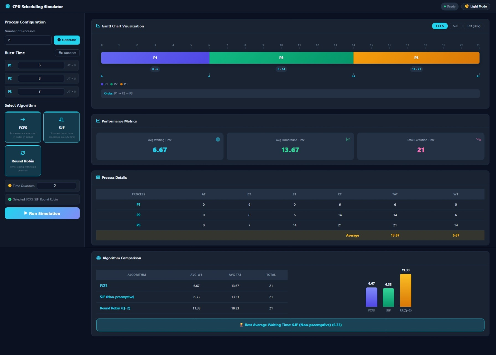
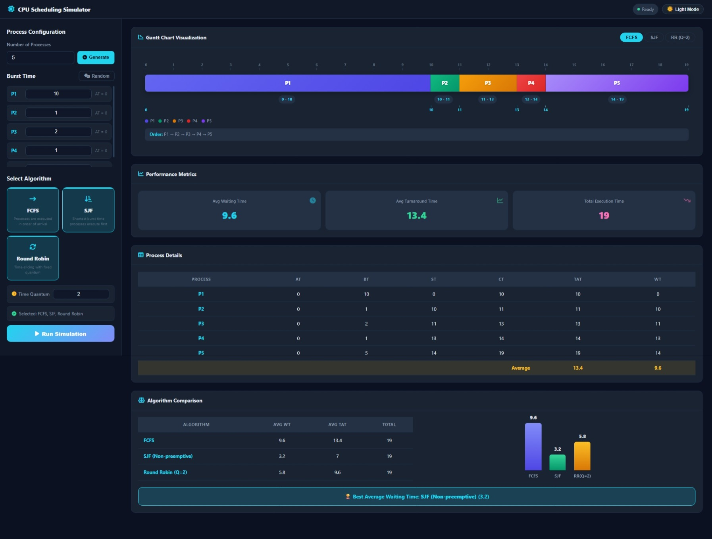
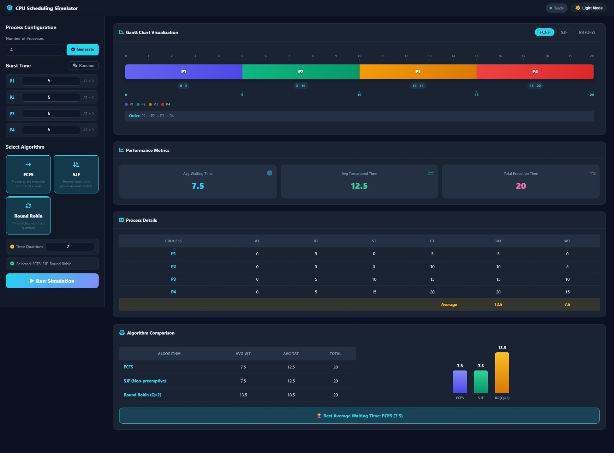
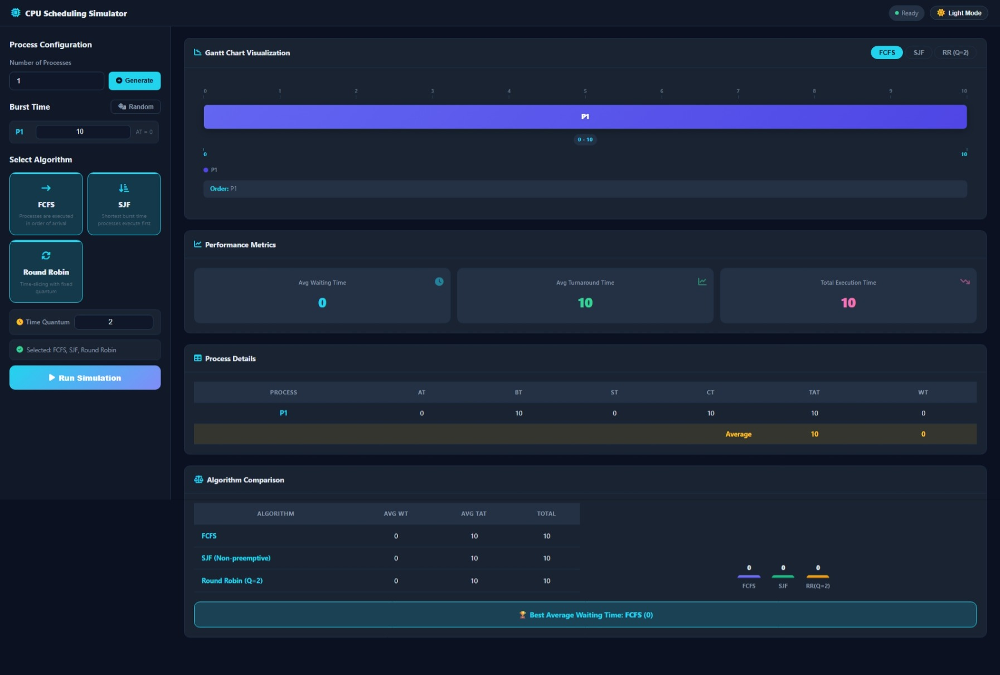

# ⚙️ CPU Scheduling Simulator

A modern, responsive web application for simulating and comparing CPU Scheduling algorithms, built with vanilla HTML, CSS, and JavaScript.

## 🚀 Features

- **Algorithms Supported:**
  - **FCFS** (First-Come, First-Served)
  - **SJF** (Shortest Job First - Non-preemptive)
  - **Round Robin** (RR with configurable Time Quantum, default $Q = 2$)
- **Simulation Setup:**
  - Configurable number of processes ($P_1$ to $P_n$)
  - All processes have Arrival Time ($AT = 0$)
  - Manual Burst Time ($BT$) input or 🎲 Randomizer
- **Visualizations & Analytics:**
  - **Precision-Aligned Gantt Chart:** Timeline ruler, time range badges, boundary timestamps, process legend, and execution order.
  - **Performance Metrics:** Average Waiting Time ($WT$), Average Turnaround Time ($TAT$), and Total Execution Time.
  - **Process Details Table:** Detailed breakdown of $AT$, $BT$, $ST$, $CT$, $TAT$, and $WT$ per process.
  - **Algorithm Comparison:** Side-by-side performance table, comparative bar chart, and best algorithm indicator.
- **UI/UX:**
  - Dark Mode & Light Mode toggle with local persistence.
  - Sleek dashboard interface inspired by modern developer tooling.

---

## 📦 วิธีเปิดใช้งานโปรแกรม

**เปิดไฟล์ `index.html` ในเว็บเบราว์เซอร์**

   ```bash
   # Windows
   start index.html

   # macOS
   open index.html

   # Linux
   xdg-open index.html
   ```


### วิธีใช้งาน

1. กรอก **จำนวน Process** (1–20) แล้วกด **Generate**
2. กรอก **Burst Time** ของแต่ละ Process หรือกดปุ่ม 🎲 **Random** เพื่อสุ่มค่า
3. เลือก **อัลกอริทึม** ที่ต้องการ (FCFS, SJF, Round Robin) — สามารถเลือกได้หลายตัวพร้อมกัน
4. สำหรับ Round Robin ให้กำหนดค่า **Time Quantum** (ค่าเริ่มต้น = 2)
5. กดปุ่ม ▶ **Run Simulation** เพื่อดูผลลัพธ์

---

## 🧰 เครื่องมือและ Version ที่ใช้ในการพัฒนา

| เครื่องมือ / เทคโนโลยี | Version | รายละเอียด |
|---|---|---|
| **HTML5** | — | โครงสร้างหน้าเว็บ (Semantic HTML) |
| **CSS3** | — | จัดรูปแบบ UI, Dark/Light Theme, Responsive Layout |
| **JavaScript (ES6+)** | — | ตรรกะอัลกอริทึม, DOM Manipulation, LocalStorage |
| **Font Awesome** | 6.5.1 | ไอคอนต่าง ๆ ใน UI (ใช้ผ่าน CDN) |
| **Visual Studio Code** | 1.96+ | Code Editor หลักในการพัฒนา |
| **Live Server** (VS Code Extension) | 5.7+ | Development Server สำหรับ Auto-reload |
| **Git / GitHub** | — | Version Control และ Collaboration |
| **Google Chrome DevTools** | — | Debug, Inspect Element, Performance Testing |

### โครงสร้างไฟล์โปรเจกต์

```
Cpu-Scheduling-Simulator/
├── index.html      # หน้าหลักของแอปพลิเคชัน
├── style.css       # สไตล์หลักและ Layout (Dashboard, Dark/Light Theme)
├── gantt.css       # สไตล์ Gantt Chart Visualization และ Animation
├── script.js       # ตรรกะอัลกอริทึมและ UI Logic
├── README.md       # เอกสารโปรเจกต์ (ไฟล์นี้)
└── .gitignore      # ไฟล์ที่ไม่ต้องการ Track ใน Git
```

---

## 🧪 ตัวอย่างข้อมูลสำหรับทดสอบ (Test Cases)

### 📐 สูตรและวิธีการคำนวณ (Calculation Formulas)

ทุก Process ในระบบเริ่มต้นที่ Arrival Time ($AT$) = 0 โดยมีสูตรการคำนวณดังนี้:

1. **Turnaround Time ($TAT$):** เวลาตั้งแต่เข้ามาจนทำงานเสร็จ
   $$\text{TAT} = \text{CT} - \text{AT}$$
   *(เนื่องจาก $AT = 0$ จะได้ $\text{TAT} = \text{CT}$)*

2. **Waiting Time ($WT$):** เวลาที่ Process ต้องรอคอยในคิว
   $$\text{WT} = \text{TAT} - \text{BT}$$
   *(หรือ $\text{WT} = \text{ST} - \text{AT}$ สำหรับ FCFS / SJF)*

3. **Average Turnaround Time ($\overline{\text{TAT}}$):** ค่าเฉลี่ย Turnaround Time
   $$\overline{\text{TAT}} = \frac{\sum_{i=1}^{n} \text{TAT}_i}{n}$$

4. **Average Waiting Time ($\overline{\text{WT}}$):** ค่าเฉลี่ย Waiting Time
   $$\overline{\text{WT}} = \frac{\sum_{i=1}^{n} \text{WT}_i}{n}$$

---

### Test Case 1 — Basic (3 Processes)

- **ข้อมูลนำเข้า:** $P_1 (BT=6), P_2 (BT=8), P_3 (BT=7)$, Time Quantum = 2

**ตารางรายละเอียด Process (Process Details - FCFS):**

| Process | AT | BT | ST | CT | TAT | WT |
|---|---|---|---|---|---|---|
| P1 | 0 | 6 | 0 | 6 | 6 | 0 |
| P2 | 0 | 8 | 6 | 14 | 14 | 6 |
| P3 | 0 | 7 | 14 | 21 | 21 | 14 |
| **Average** | - | - | - | - | **13.67** | **6.67** |

#### 📝 แสดงวิธีคำนวณแต่ละอัลกอริทึม:

- **1. FCFS (First-Come, First-Served):**
  - ลำดับการรัน: $P_1 (0 \rightarrow 6) \rightarrow P_2 (6 \rightarrow 14) \rightarrow P_3 (14 \rightarrow 21)$
  - $P_1$: $\text{CT} = 6 \implies \text{TAT} = 6 - 0 = 6, \quad \text{WT} = 6 - 6 = 0$
  - $P_2$: $\text{CT} = 14 \implies \text{TAT} = 14 - 0 = 14, \quad \text{WT} = 14 - 8 = 6$
  - $P_3$: $\text{CT} = 21 \implies \text{TAT} = 21 - 0 = 21, \quad \text{WT} = 21 - 7 = 14$
  - $\text{Avg TAT} = \frac{6 + 14 + 21}{3} = \frac{41}{3} \approx \mathbf{13.67}$
  - $\text{Avg WT} = \frac{0 + 6 + 14}{3} = \frac{20}{3} \approx \mathbf{6.67}$

- **2. SJF (Shortest Job First - Non-preemptive):**
  - เรียงตาม BT: $P_1 (6) \rightarrow P_3 (7) \rightarrow P_2 (8)$
  - ลำดับการรัน: $P_1 (0 \rightarrow 6) \rightarrow P_3 (6 \rightarrow 13) \rightarrow P_2 (13 \rightarrow 21)$
  - $P_1$: $\text{CT} = 6 \implies \text{TAT} = 6, \quad \text{WT} = 6 - 6 = 0$
  - $P_3$: $\text{CT} = 13 \implies \text{TAT} = 13, \quad \text{WT} = 13 - 7 = 6$
  - $P_2$: $\text{CT} = 21 \implies \text{TAT} = 21, \quad \text{WT} = 21 - 8 = 13$
  - $\text{Avg TAT} = \frac{6 + 13 + 21}{3} = \frac{40}{3} \approx \mathbf{13.33}$
  - $\text{Avg WT} = \frac{0 + 6 + 13}{3} = \frac{19}{3} \approx \mathbf{6.33}$

- **3. Round Robin ($Q = 2$):**
  - ลำดับการรัน: $P_1(0\rightarrow2) \rightarrow P_2(2\rightarrow4) \rightarrow P_3(4\rightarrow6) \rightarrow P_1(6\rightarrow8) \rightarrow P_2(8\rightarrow10) \rightarrow P_3(10\rightarrow12) \rightarrow P_1(12\rightarrow14) \rightarrow P_2(14\rightarrow16) \rightarrow P_3(16\rightarrow18) \rightarrow P_2(18\rightarrow20) \rightarrow P_3(20\rightarrow21)$
  - เวลาเสร็จสิ้น (CT): $P_1 = 14, \quad P_2 = 20, \quad P_3 = 21$
  - $P_1$: $\text{TAT} = 14 - 0 = 14, \quad \text{WT} = 14 - 6 = 8$
  - $P_2$: $\text{TAT} = 20 - 0 = 20, \quad \text{WT} = 20 - 8 = 12$
  - $P_3$: $\text{TAT} = 21 - 0 = 21, \quad \text{WT} = 21 - 7 = 14$
  - $\text{Avg TAT} = \frac{14 + 20 + 21}{3} = \frac{55}{3} \approx \mathbf{18.33}$
  - $\text{Avg WT} = \frac{8 + 12 + 14}{3} = \frac{34}{3} \approx \mathbf{11.33}$

**ผลลัพธ์เปรียบเทียบแต่ละอัลกอริทึม (Algorithm Comparison):**

| Algorithm | Avg Waiting Time (WT) | Avg Turnaround Time (TAT) | Total Execution Time |
|---|---|---|---|
| FCFS | 6.67 | 13.67 | 21 |
| SJF | 6.33 | 13.33 | 21 |
| RR (Q=2) | 11.33 | 18.33 | 21 |

**ภาพผลลัพธ์จากโปรแกรม:**



---

### Test Case 2 — Varied Burst Times (5 Processes)

- **ข้อมูลนำเข้า:** $P_1 (BT=10), P_2 (BT=1), P_3 (BT=2), P_4 (BT=1), P_5 (BT=5)$, Time Quantum = 2

**ตารางรายละเอียด Process (Process Details - FCFS):**

| Process | AT | BT | ST | CT | TAT | WT |
|---|---|---|---|---|---|---|
| P1 | 0 | 10 | 0 | 10 | 10 | 0 |
| P2 | 0 | 1 | 10 | 11 | 11 | 10 |
| P3 | 0 | 2 | 11 | 13 | 13 | 11 |
| P4 | 0 | 1 | 13 | 14 | 14 | 13 |
| P5 | 0 | 5 | 14 | 19 | 19 | 14 |
| **Average** | - | - | - | - | **13.40** | **9.60** |

#### 📝 แสดงวิธีคำนวณแต่ละอัลกอริทึม:

- **1. FCFS (First-Come, First-Served):**
  - ลำดับการรัน: $P_1 (0 \rightarrow 10) \rightarrow P_2 (10 \rightarrow 11) \rightarrow P_3 (11 \rightarrow 13) \rightarrow P_4 (13 \rightarrow 14) \rightarrow P_5 (14 \rightarrow 19)$
  - $\text{TAT}: P_1=10, P_2=11, P_3=13, P_4=14, P_5=19$
  - $\text{WT}: P_1=0, P_2=10, P_3=11, P_4=13, P_5=14$
  - $\text{Avg TAT} = \frac{10 + 11 + 13 + 14 + 19}{5} = \frac{67}{5} = \mathbf{13.40}$
  - $\text{Avg WT} = \frac{0 + 10 + 11 + 13 + 14}{5} = \frac{48}{5} = \mathbf{9.60}$

- **2. SJF (Shortest Job First - Non-preemptive):**
  - เรียงตาม BT (Tie-breaker ด้วยชื่อ Process): $P_2 (1) \rightarrow P_4 (1) \rightarrow P_3 (2) \rightarrow P_5 (5) \rightarrow P_1 (10)$
  - ลำดับการรัน: $P_2 (0 \rightarrow 1) \rightarrow P_4 (1 \rightarrow 2) \rightarrow P_3 (2 \rightarrow 4) \rightarrow P_5 (4 \rightarrow 9) \rightarrow P_1 (9 \rightarrow 19)$
  - เวลาเสร็จสิ้น (CT): $P_2 = 1, P_4 = 2, P_3 = 4, P_5 = 9, P_1 = 19$
  - $\text{TAT}: P_1=19, P_2=1, P_3=4, P_4=2, P_5=9$
  - $\text{WT} = \text{TAT} - \text{BT}$:
    - $P_1: 19 - 10 = 9$
    - $P_2: 1 - 1 = 0$
    - $P_3: 4 - 2 = 2$
    - $P_4: 2 - 1 = 1$
    - $P_5: 9 - 5 = 4$
  - $\text{Avg TAT} = \frac{19 + 1 + 4 + 2 + 9}{5} = \frac{35}{5} = \mathbf{7.00}$
  - $\text{Avg WT} = \frac{9 + 0 + 2 + 1 + 4}{5} = \frac{16}{5} = \mathbf{3.20}$

- **3. Round Robin ($Q = 2$):**
  - คิวการทำงาน: $P_1(2) \rightarrow P_2(1) \rightarrow P_3(2) \rightarrow P_4(1) \rightarrow P_5(2) \rightarrow P_1(2) \rightarrow P_5(2) \rightarrow P_1(2) \rightarrow P_5(1) \rightarrow P_1(2) \rightarrow P_1(2)$
  - เวลาเสร็จสิ้น (CT): $P_2=3, P_3=5, P_4=6, P_5=15, P_1=19$
  - $\text{TAT}: P_1=19, P_2=3, P_3=5, P_4=6, P_5=15$
  - $\text{WT} = \text{TAT} - \text{BT}$:
    - $P_1: 19 - 10 = 9$
    - $P_2: 3 - 1 = 2$
    - $P_3: 5 - 2 = 3$
    - $P_4: 6 - 1 = 5$
    - $P_5: 15 - 5 = 10$
  - $\text{Avg TAT} = \frac{19 + 3 + 5 + 6 + 15}{5} = \frac{48}{5} = \mathbf{9.60}$
  - $\text{Avg WT} = \frac{9 + 2 + 3 + 5 + 10}{5} = \frac{29}{5} = \mathbf{5.80}$

**ผลลัพธ์เปรียบเทียบแต่ละอัลกอริทึม (Algorithm Comparison):**

| Algorithm | Avg Waiting Time (WT) | Avg Turnaround Time (TAT) | Total Execution Time |
|---|---|---|---|
| FCFS | 9.60 | 13.40 | 19 |
| SJF | 3.20 | 7.00 | 19 |
| RR (Q=2) | 5.80 | 9.60 | 19 |

> 💡 **หมายเหตุ:** SJF จะให้ค่า Average Waiting Time ต่ำที่สุดเสมอ เมื่อ Process ทุกตัวมี Arrival Time = 0

**ภาพผลลัพธ์จากโปรแกรม:**



---

### Test Case 3 — Equal Burst Times (4 Processes)

- **ข้อมูลนำเข้า:** $P_1 (BT=5), P_2 (BT=5), P_3 (BT=5), P_4 (BT=5)$, Time Quantum = 2

**ตารางรายละเอียด Process (Process Details - FCFS):**

| Process | AT | BT | ST | CT | TAT | WT |
|---|---|---|---|---|---|---|
| P1 | 0 | 5 | 0 | 5 | 5 | 0 |
| P2 | 0 | 5 | 5 | 10 | 10 | 5 |
| P3 | 0 | 5 | 10 | 15 | 15 | 10 |
| P4 | 0 | 5 | 15 | 20 | 20 | 15 |
| **Average** | - | - | - | - | **12.50** | **7.50** |

#### 📝 แสดงวิธีคำนวณแต่ละอัลกอริทึม:

- **1. FCFS & SJF:**
  - เมื่อทุก Process มี Burst Time เท่ากัน ($BT = 5$) การเรียงลำดับของ SJF จะเหมือนกับ FCFS ทุกประการ
  - ลำดับการรัน: $P_1 (0 \rightarrow 5) \rightarrow P_2 (5 \rightarrow 10) \rightarrow P_3 (10 \rightarrow 15) \rightarrow P_4 (15 \rightarrow 20)$
  - $\text{TAT}: P_1=5, P_2=10, P_3=15, P_4=20$
  - $\text{WT}: P_1=0, P_2=5, P_3=10, P_4=15$
  - $\text{Avg TAT} = \frac{5 + 10 + 15 + 20}{4} = \frac{50}{4} = \mathbf{12.50}$
  - $\text{Avg WT} = \frac{0 + 5 + 10 + 15}{4} = \frac{30}{4} = \mathbf{7.50}$

- **2. Round Robin ($Q = 2$):**
  - แต่ละรอบประมวลผลคนละ 2 หน่วย:
    - รอบที่ 1: $P_1(0\rightarrow2), P_2(2\rightarrow4), P_3(4\rightarrow6), P_4(6\rightarrow8)$ [เหลือคนละ 3]
    - รอบที่ 2: $P_1(8\rightarrow10), P_2(10\rightarrow12), P_3(12\rightarrow14), P_4(14\rightarrow16)$ [เหลือคนละ 1]
    - รอบที่ 3: $P_1(16\rightarrow17, \text{เสร็จ}), P_2(17\rightarrow18, \text{เสร็จ}), P_3(18\rightarrow19, \text{เสร็จ}), P_4(19\rightarrow20, \text{เสร็จ})$
  - เวลาเสร็จสิ้น (CT): $P_1 = 17, P_2 = 18, P_3 = 19, P_4 = 20$
  - $\text{TAT}: P_1=17, P_2=18, P_3=19, P_4=20$
  - $\text{WT} = \text{TAT} - \text{BT}$:
    - $P_1: 17 - 5 = 12$
    - $P_2: 18 - 5 = 13$
    - $P_3: 19 - 5 = 14$
    - $P_4: 20 - 5 = 15$
  - $\text{Avg TAT} = \frac{17 + 18 + 19 + 20}{4} = \frac{74}{4} = \mathbf{18.50}$
  - $\text{Avg WT} = \frac{12 + 13 + 14 + 15}{4} = \frac{54}{4} = \mathbf{13.50}$

**ผลลัพธ์เปรียบเทียบแต่ละอัลกอริทึม (Algorithm Comparison):**

| Algorithm | Avg Waiting Time (WT) | Avg Turnaround Time (TAT) | Total Execution Time |
|---|---|---|---|
| FCFS | 7.50 | 12.50 | 20 |
| SJF | 7.50 | 12.50 | 20 |
| RR (Q=2) | 13.50 | 18.50 | 20 |

- FCFS และ SJF จะให้ผลลัพธ์เหมือนกันทุกประการ (Avg WT = 7.50, Avg TAT = 12.50) เนื่องจากทุก Process มี Burst Time เท่ากัน
- ใช้ทดสอบว่าทั้งสองอัลกอริทึมให้ผลตรงกันเมื่อ BT เท่ากันหมด

**ภาพผลลัพธ์จากโปรแกรม:**



---

### Test Case 4 — Single Process

- **ข้อมูลนำเข้า:** $P_1 (BT=10)$, Time Quantum = 2

**ตารางรายละเอียด Process (Process Details - FCFS):**

| Process | AT | BT | ST | CT | TAT | WT |
|---|---|---|---|---|---|---|
| P1 | 0 | 10 | 0 | 10 | 10 | 0 |
| **Average** | - | - | - | - | **10.00** | **0.00** |

#### 📝 แสดงวิธีคำนวณแต่ละอัลกอริทึม:

- **ทุกอัลกอริทึม (FCFS, SJF, RR):**
  - มีเพียง Process เดียว ไม่มี Process อื่นมาแย่งคิว
  - $\text{CT} = 10$
  - $\text{TAT} = \text{CT} - \text{AT} = 10 - 0 = \mathbf{10.00}$
  - $\text{WT} = \text{TAT} - \text{BT} = 10 - 10 = \mathbf{0.00}$
  - $\text{Avg TAT} = \frac{10}{1} = \mathbf{10.00}$
  - $\text{Avg WT} = \frac{0}{1} = \mathbf{0.00}$

**ผลลัพธ์เปรียบเทียบแต่ละอัลกอริทึม (Algorithm Comparison):**

| Algorithm | Avg Waiting Time (WT) | Avg Turnaround Time (TAT) | Total Execution Time |
|---|---|---|---|
| FCFS | 0.00 | 10.00 | 10 |
| SJF | 0.00 | 10.00 | 10 |
| RR (Q=2) | 0.00 | 10.00 | 10 |

- เมื่อมีเพียง Process เดียว ทุกอัลกอริทึมจะให้ผลลัพธ์เหมือนกันทั้งหมด (WT = 0, TAT = 10, Total Execution = 10)

**ภาพผลลัพธ์จากโปรแกรม:**



---

## 🤖 เครื่องมือ AI ที่ใช้ในการพัฒนา

### เครื่องมือ AI หลัก

| เครื่องมือ AI | วัตถุประสงค์ |
|---|---|
| **Google Gemini** | ใช้ในการตรวจสอบความถูกต้อง , จัดทำ README, และ Review โค้ด|
| **Claude code** | ใช้ในการ Generate โค้ด, Debug, และปรึกษาเรื่องการออกแบบอัลกอริทึม |
| **Antigravity (Google Deepmind)** | ใช้ในการ Pair Programming |

### ตัวอย่าง Prompt สำคัญที่ใช้

#### 1. Prompt สำหรับสร้างโครงสร้างโปรเจกต์

```
สร้างเว็บแอปพลิเคชัน CPU Scheduling Simulator ด้วย Vanilla HTML, CSS, JavaScript
ที่รองรับอัลกอริทึม FCFS, SJF (Non-preemptive), และ Round Robin
โดยผู้ใช้สามารถกำหนดจำนวน Process และ Burst Time ได้เอง
ทุก Process มี Arrival Time = 0
แสดงผลเป็น Gantt Chart, Performance Metrics, และตารางรายละเอียด
```

#### 2. Prompt สำหรับออกแบบ UI/UX

```
ออกแบบ UI แบบ Dashboard สไตล์ Modern Developer Tool
รองรับ Dark Mode และ Light Mode พร้อมบันทึกการตั้งค่าลง LocalStorage
ใช้ Font Awesome สำหรับไอคอน และ CSS Custom Properties สำหรับ Theming
Layout เป็นแบบ 2 คอลัมน์ (Left Panel = Config, Right Panel = Results)
```

#### 3. Prompt สำหรับ Gantt Chart

```
สร้าง Gantt Chart Visualization ที่แสดง:
- Timeline Ruler พร้อมหน่วยเวลา
- แต่ละ Process มีสีที่แตกต่างกัน
- แสดง Time Range Badge บนแต่ละ Block
- แสดง Boundary Timestamps ที่จุดเริ่มและสิ้นสุด
- มี Process Legend แสดงสีและชื่อ Process
- แสดง Execution Order ลำดับการทำงาน
```

#### 4. Prompt สำหรับ Algorithm Comparison

```
เพิ่มส่วน Algorithm Comparison ที่:
- แสดงตารางเปรียบเทียบ Avg WT, Avg TAT, Total Time ของทุกอัลกอริทึม
- แสดง Bar Chart เปรียบเทียบค่า Metrics แบบ Visual
- ระบุ Best Algorithm จาก Avg Waiting Time ต่ำสุด
- รองรับการเลือกเปรียบเทียบ 2-3 อัลกอริทึมพร้อมกัน
```

#### 5. Prompt สำหรับ Debug และ Edge Cases

```
ตรวจสอบและแก้ไข Edge Cases ต่อไปนี้:
- กรณี Process เดียว (n=1) ทุกอัลกอริทึมต้องให้ WT=0
- กรณี Burst Time เท่ากันหมด FCFS และ SJF ต้องได้ผลลัพธ์เหมือนกัน
- กรณี Time Quantum >= Max Burst Time, Round Robin ต้องทำงานเหมือน FCFS
- ตรวจสอบ Input Validation สำหรับค่าที่ไม่ใช่จำนวนเต็มบวก
```

---

## 👥 สมาชิกในกลุ่ม

- นาย พิธิพัฒน์ เจียง รหัส 1670706959 Sec 327F หน้าที่ การออกแบบและพัฒนาอัลกอริทึม
- นาย พัฒธิวัฒน์ เจียง รหัส 1670706967 Sec 327F หน้าที่ การออกแบบ User Interface
- นาย ธนกฤต พวงแก้ว รหัส 1670703998 Sec 327F หน้าที่ การออกแบบกรณีทดสอบ
- นาย ณัฐวุฒิ อุดมศักดิ์ รหัส 1670706975 Sec 327F หน้าที่ การออกแบบกรณีทดสอบ
